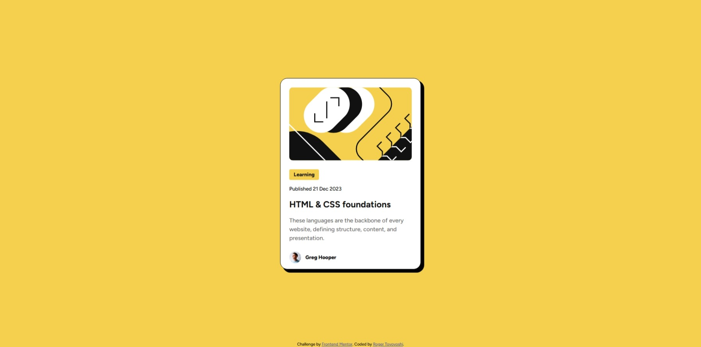

# Frontend Mentor - Blog preview card solution

This is a solution to the [Blog preview card challenge on Frontend Mentor](https://www.frontendmentor.io/challenges/blog-preview-card-ckPaj01IcS). Frontend Mentor challenges help you improve your coding skills by building realistic projects. 

## Table of contents

- [Overview](#overview)
  - [The challenge](#the-challenge)
  - [Screenshot](#screenshot)
  - [Links](#links)
- [My process](#my-process)
  - [Built with](#built-with)
  - [What I learned](#what-i-learned)
  - [Continued development](#continued-development)
  - [Useful resources](#useful-resources)
- [Author](#author)

## Overview

### The challenge

Users should be able to:

- See hover and focus states for all interactive elements on the page

### Screenshot

### Links

- Solution URL: https://github.com/RogerToyoyoshi/Blog-preview-card
- Live Site URL: https://blog-preview-card-one-azure.vercel.app/

## My process

For this project i have used the figma reference file to set the element hierarchy and proportions, then tuned the font sizes and the flex display in each parent element to match the references.

### Built with

- Semantic HTML5 markup
- Flexbox
- Mobile-first workflow

### What I learned

I have learned a lot on how to use figma files for reference.
I also learned the "align-self" property to set an alignment to a single element inside a flex container.
Additionally, i figured that setting the "box-sizing" property in all elements to "border-box" would fix size distortions in the page.

### Continued development

I want to keep improving with flexbox and in the future gridbox as well.

### Useful resources

- [align-self](https://www.w3schools.com/cssref/css3_pr_align-self.php) - Using this property you can set an alignment to a single element inside a flexbox container. This helped me correctly set the position of the "Learning" element.

## Author

- Frontend Mentor - [@RogerToyoyoshi](https://www.frontendmentor.io/profile/RogerToyoyoshi)
- Github - [RogerToyoyoshi](https://github.com/RogerToyoyoshi)